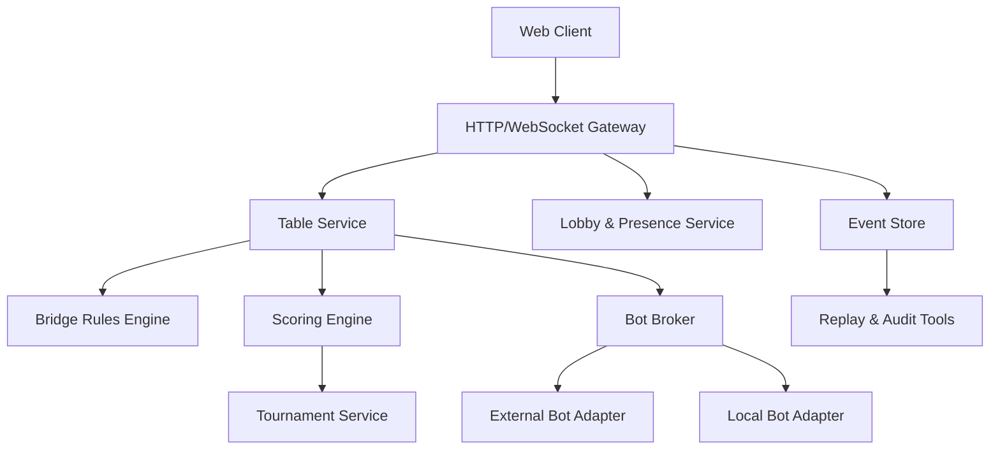

# Alternative Online Bridge: Overall Plan

This project aims to provide an open, self-hostable online bridge platform that can be run by clubs, federations, teachers, casual groups, or independent organizers without depending on a single centralized service.

The first principle is that the bridge table, tournament logic, user interface, and bot integration should be separable. A small club should be able to run one server with human players and built-in bot adapters. A larger organizer should be able to run multiple table servers, connect external scoring tools, and allow approved third-party bots.

## Goals

1. Let bridge groups self-host their own playing server.
2. Support both member-only and public participation modes.
3. Provide a stable interface for external bridge bots.
4. Support solo bot tables, human tables, team matches, duplicate pairs, and comparison across two tables.
5. Start with a web client, designed carefully for both desktop and mobile use.
6. Keep the system open enough that different communities can modify policy, UI, scoring, and integrations.

## Non-Goals For The First Version

1. Do not build a full federation-grade tournament management system immediately.
2. Do not require every server to join a global account system.
3. Do not try to solve anti-cheating perfectly in the first release.
4. Do not force one official bot, one official scoring policy, or one official deployment provider.
5. Do not optimize first for spectators, streaming, teaching tools, or advanced director tools, though the architecture should leave room for them.

## Product Shape

The platform should be usable in four main modes:

1. Casual table
   - Four human players, or mixed human/bot seats.
   - Host creates a table, invites players, chooses scoring and board source.
   - Good for clubs, friends, lessons, and pickup games.

2. Solo practice
   - One human starts a table with three bots.
   - User can choose convention profile, difficulty, and whether to show post-board analysis.
   - This mode is important because it gives the project utility before a large player network exists.

3. Team match
   - Two tables play the same boards in opposite directions.
   - Server tracks closed/open room, lineups, board completion, IMP comparison, and match state.
   - The first version can support simple head-to-head teams before larger Swiss or round-robin events.

4. Duplicate pairs
   - Multiple tables play shared boards.
   - Server supports movement, board results, matchpoints/IMPs, rankings, and late result correction.
   - The first version can start with Howell/Mitchell-like simple movements or even a manual movement mode.

## Architecture Overview

Recommended high-level components:



### Core Modules

1. Web client
   - Provides lobby, table UI, bidding box, play area, convention card display, results, and mobile views.
   - Communicates through WebSocket for live table state and HTTP for setup/history.

2. Gateway
   - Handles authentication, sessions, rate limits, WebSocket connection lifecycle, and API versioning.
   - Should stay thin; bridge state transitions should live deeper in the system.

3. Table service
   - Owns table state, seats, dealer/vulnerability, auction, play, claims, undo requests, alerts, chat, and result finalization.
   - Should be deterministic and event-driven.

4. Rules engine
   - Validates legal calls, legal plays, trick winner, revoke detection support, completion rules, and claim/undo state.
   - Should be usable independently in tests, bots, and replay tools.

5. Scoring engine
   - Computes contract score, IMPs, matchpoints, victory points, board-a-match, and comparison across tables.
   - Should accept finalized board results rather than live table internals.

6. Tournament service
   - Handles events, sessions, boards, movements, assignments, team rosters, pair numbers, standings, and director corrections.
   - Can be thin in version 1, but should not be fused into table state.

7. Bot broker
   - Mediates between table service and bots.
   - Enforces timeouts, validates bot responses, normalizes convention/profile metadata, and protects the server from unstable bot processes.

8. Event store
   - Records append-only table and tournament events.
   - Enables replay, audit, reconnection, bug reproduction, and later anti-cheating analysis.

## Deployment Model

The default deployment should be simple:

1. Single-node deployment
   - One container or compose stack.
   - Includes web app, API server, database, and optional built-in bot adapter.
   - Suitable for clubs and small events.

2. Split deployment
   - Web/API server, worker processes, database, and bot adapters can be scaled separately.
   - Useful for larger tournaments or heavier bot usage.

3. Federated-friendly design
   - Servers do not need a central registry.
   - A server may optionally publish public event metadata.
   - Identity should support local accounts first, with optional OAuth/OpenID Connect later.

Suggested initial stack:

1. TypeScript for shared protocol types, web client, and server.
2. PostgreSQL for persistent state.
3. Redis or an in-process queue initially for presence and short-lived coordination.
4. WebSocket for live table updates.
5. Docker Compose as the first deployment target.

The exact stack can change, but the shared protocol and event model should be treated as first-class artifacts from the beginning.

## Domain Model

Important entities:

1. Server
   - The self-hosted installation and its local policies.

2. Organization
   - A club, school, federation, or informal group.

3. User
   - A local account, guest, bot identity, or imported member.

4. Table
   - Four seats, current deal, auction/play state, permissions, clock, chat, and result.

5. Seat
   - North, East, South, West.
   - May be occupied by a human, bot, reserved player, substitute, or empty placeholder.

6. Board
   - Dealer, vulnerability, deal, board number, source, and visibility policy.

7. Result
   - Contract, declarer, tricks, score, adjustments, claims, and audit trail.

8. Match
   - A team-vs-team unit containing one or more board sets and table assignments.

9. Session
   - A duplicate event or match segment.

10. Bot profile
   - Bot endpoint, supported protocols, conventions, speed, explanations, and trust level.

## Event Model

Use an append-only event log for table actions. Derived table state can be rebuilt from events.

Representative table events:

1. `table.created`
2. `seat.assigned`
3. `board.loaded`
4. `auction.call_made`
5. `auction.alert_added`
6. `auction.completed`
7. `play.card_played`
8. `play.claim_requested`
9. `play.claim_accepted`
10. `play.completed`
11. `result.finalized`
12. `director.adjustment_applied`

Benefits:

1. Reconnection is simpler.
2. Bugs can be reproduced by replaying events.
3. Tournament audits become possible.
4. Bots can be tested against recorded histories.
5. Multiple clients can derive the same state consistently.

## Bot Interface

The bot interface should be explicit, versioned, and transport-neutral.

Recommended first transport:

1. HTTP callback or local subprocess for easy adoption.
2. WebSocket/gRPC can be added later for lower latency and persistent bot sessions.

Bot responsibilities:

1. Receive the current legal public/private state for its seat.
2. Return a legal bid, pass/double/redouble, card play, claim response, or explanation.
3. Provide metadata about convention profile and capabilities.
4. Never be trusted as a rules authority; the server validates every action.

Core API shape:

```text
GET /bot/v1/capabilities
POST /bot/v1/choose-call
POST /bot/v1/choose-card
POST /bot/v1/explain-call
POST /bot/v1/explain-play
POST /bot/v1/claim-response
```

Every request should include:

1. Protocol version.
2. Bot seat.
3. Board metadata.
4. Vulnerability and dealer.
5. Full auction so far.
6. Play history so far.
7. Bot hand, when appropriate.
8. Legal actions supplied by the server.
9. Time budget.
10. Convention/profile identifiers.

Every response should include:

1. Chosen action.
2. Optional explanation.
3. Confidence/debug metadata, if enabled.
4. Whether the bot used fallback behavior.

The server should enforce:

1. Legal action validation.
2. Timeout fallback.
3. Bot crash isolation.
4. Per-bot rate limits.
5. No hidden information leakage across seats.

## Table Experience

The table should support:

1. Seat selection and substitution.
2. Human/bot mixed seats.
3. Bidding box with alerts and explanations.
4. Card play with legal-card highlighting.
5. Claim and concession flow.
6. Undo requests with policy controls.
7. Table chat and director/private messages.
8. Reconnection after browser refresh or network loss.
9. Spectator mode, eventually, with delay controls.

Policy should be configurable by host:

1. Allow guests.
2. Allow robots.
3. Allow kibitzers.
4. Allow undo.
5. Require self-alerts.
6. Allow table chat.
7. Use clock or no clock.
8. Public results or private results.

## Mobile Web Design

Mobile should not be treated as a squeezed desktop table. It needs its own layout behavior.

Recommended mobile principles:

1. Keep the user's hand at the bottom in a large touch target area.
2. Use a compact auction panel that can expand when needed.
3. Show current trick and contract persistently.
4. Use gestures carefully, but always provide visible tap controls.
5. Avoid requiring drag-and-drop for card play.
6. Keep explanations and alerts in bottom sheets or slide-over panels.
7. Support portrait first; landscape can become a more desktop-like table.
8. Make reconnect/resume highly visible.

Desktop layout:

1. Four-player table geometry.
2. Persistent auction/history panel.
3. Chat/results side panel.
4. Keyboard shortcuts for bidding and play later.

Mobile layout:

1. Single active-seat perspective.
2. Bottom hand strip.
3. Center trick area.
4. Collapsible auction/result/chat panels.
5. Large bidding grid with clear suit/level/pass/double/redouble controls.

## Tournament Support Roadmap

Phase 1: Core table and solo play

1. Deal generation/import.
2. Four-seat table state.
3. Human and bot seats.
4. Rubber/Chicago or simple duplicate scoring.
5. Basic result history.
6. Reconnection and event replay.

Phase 2: Two-table team match

1. Same boards at two tables.
2. Open/closed room assignments.
3. IMP comparison.
4. Match scoreboard.
5. Board-by-board review.

Phase 3: Small duplicate pairs

1. Multi-table session.
2. Shared board sets.
3. Simple movement support.
4. Matchpoint scoring.
5. Ranking and traveler views.

Phase 4: Organizer tools

1. Director console.
2. Manual adjustments.
3. Substitutions.
4. Late plays and corrections.
5. CSV/PBN export.

Phase 5: Federation and ecosystem features

1. Optional public server directory.
2. Bot marketplace/registry format.
3. Rating integration hooks.
4. Anti-cheating analytics.
5. Teaching and commentary tools.

## API Boundaries

Recommended API surfaces:

1. Public client API
   - Auth, lobby, table actions, tournament views, user preferences.

2. Bot API
   - Minimal bridge state and action requests.

3. Admin API
   - Server settings, organizations, event setup, bot registration, member import.

4. Export API
   - PBN, LIN, CSV, JSON event logs, score summaries.

5. Internal service API
   - Optional later; avoid over-splitting too early.

## Open Protocols And File Formats

The project should favor existing bridge ecosystem formats where practical:

1. PBN for board import/export.
2. LIN import/export eventually for compatibility with existing hand records.
3. CSV for simple result exports.
4. JSON event logs for exact replay.
5. OpenAPI or JSON Schema for HTTP APIs.
6. Versioned TypeScript protocol package for client/server/bot messages.

## Trust And Governance

Because the goal is to avoid centralization, governance matters as much as code.

Recommended project principles:

1. Open-source license that permits club and commercial hosting.
2. Public protocol specs.
3. No mandatory central account service.
4. Portable data export.
5. Clear plugin/bot interface.
6. Local server policy control.
7. Public compatibility tests for bots and servers.

License candidates:

1. AGPL-3.0 if the project wants network-service modifications to remain open.
2. Apache-2.0 or MIT if the project wants maximum adoption by clubs and vendors.

This should be decided early because it shapes contributions and hosting incentives.

## First Milestone Proposal

Build a playable, self-hosted vertical slice:

1. Create a table.
2. Join as one human.
3. Fill other seats with a simple bot.
4. Bid a full hand.
5. Play a full hand.
6. Validate all legal actions server-side.
7. Finalize and score the board.
8. Persist an event log.
9. Reconnect and replay current table state.
10. Run from Docker Compose.

This milestone proves the architecture without needing tournament complexity.

## Early Technical Decisions To Make

1. License: AGPL-3.0, Apache-2.0, MIT, or dual license.
2. Initial language/runtime: TypeScript full-stack is the most straightforward option.
3. Database: PostgreSQL is recommended.
4. Event model: append-only events with snapshots.
5. Bot transport: HTTP first, subprocess adapter second.
6. Frontend framework: React/Vue/Svelte; choose based on maintainer preference.
7. Mobile target: responsive web first, PWA later.
8. Deployment: Docker Compose first.

## Suggested Repository Structure

```text
apps/
  web/
  server/
packages/
  protocol/
  bridge-rules/
  scoring/
  bot-sdk/
  test-fixtures/
docs/
  ROADMAP.md
  protocol/
  architecture/
  deployment/
examples/
  bots/
  docker-compose/
```

## Risks

1. Bridge rules have many edge cases.
   - Mitigation: isolate rules engine and build fixture-heavy tests.

2. Bot interfaces can leak hidden information.
   - Mitigation: bot broker creates per-seat filtered state and tests information boundaries.

3. Mobile table UI can become cramped.
   - Mitigation: design mobile as its own interaction model.

4. Tournament logic can explode in scope.
   - Mitigation: start with solo/casual table, then two-table team match, then pairs.

5. Self-hosting can be too difficult for clubs.
   - Mitigation: Docker Compose, clear admin UI, backup/restore, and conservative defaults.

6. Fragmentation across servers.
   - Mitigation: publish compatibility specs and conformance tests.

## Next Steps

1. Choose license and initial tech stack.
2. Define the first version of table events and bot API schemas.
3. Build the rules engine test fixture format.
4. Create a minimal web table prototype.
5. Implement a simple random/legal bot adapter.
6. Add Docker Compose for local self-hosting.
7. Run a first playable solo-table demo.
